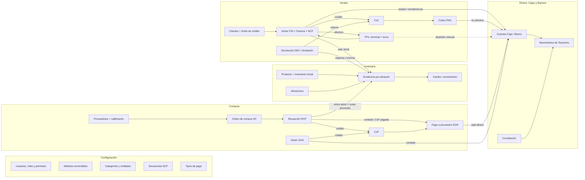
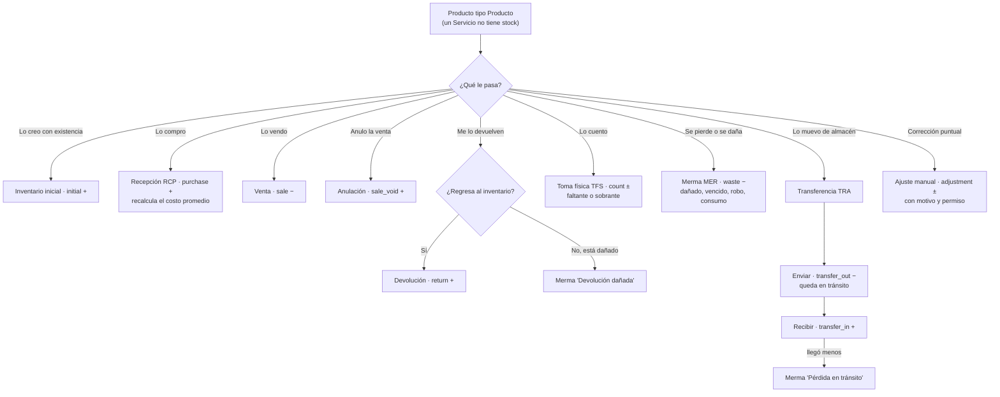
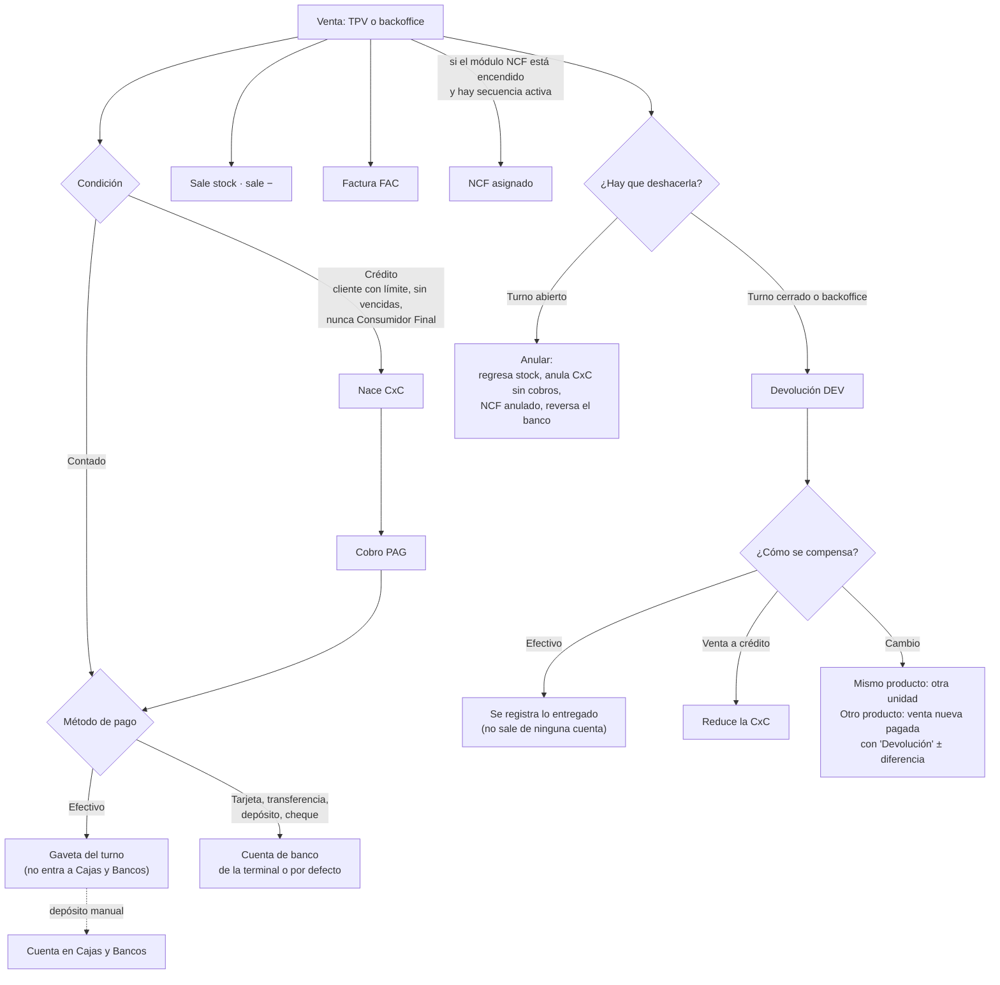
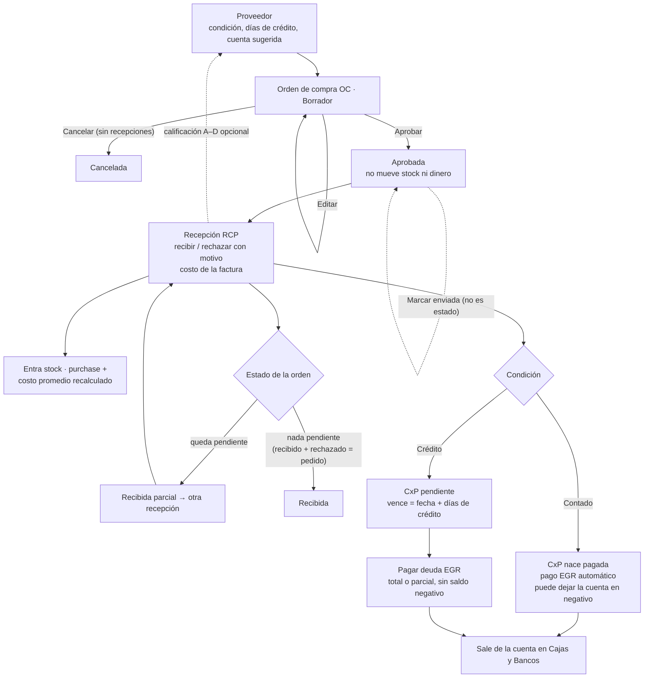
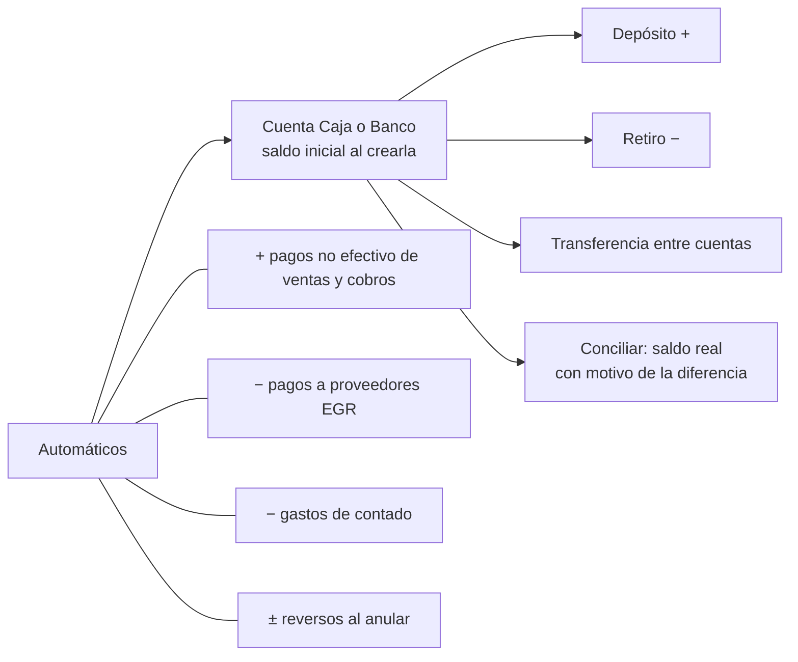

# ZertixPOS v1.5.0 — Cómo se conecta todo

Mapa del sistema al cerrar la Fase 5, para probar de punta a punta. El detalle de cada fase está en `docs/features/v1.5.0.md`.

---

## 1. Correcciones a la explicación

Tu explicación coincide con lo construido en lo grande. Estos son los puntos donde el sistema funciona distinto:

1. **Registrar lo que ya hay tiene dos caminos, no uno:**
   - **Inventario inicial:** al crear el producto (pestaña Inventario). Entra como tipo `initial`, con el costo que escribiste. No es compra.
   - **Toma física:** corrige lo que hay contra lo que dice el sistema, en un producto que ya existe.
2. **La toma física no crea mermas.** La diferencia (faltante o sobrante) entra como "Ajuste por toma física" (`count`). Las mermas nacen de tres lados:
   - A mano: dañado, vencido, robo o extravío, consumo interno.
   - De una devolución dañada que no regresa al inventario.
   - De una transferencia que llegó incompleta ("Pérdida en tránsito").
3. **Devoluciones:** existen desde v1.4.0. En esta versión se conectaron con las mermas. Las reglas:
   - Venta de un turno **abierto**: se **anula**.
   - Venta de un turno **cerrado** o hecha en backoffice: se **devuelve**.
   - Cambio por el mismo producto: sale otra unidad, sin dinero.
   - Cambio por otro producto: nace una venta nueva, pagada con "Devolución". Si el nuevo vale más, la diferencia se cobra en efectivo; si vale menos, se entrega.
   - Devolución de una venta a crédito: reduce la CxC del cliente.
   - El efectivo de una devolución **solo se registra**: no sale de ningún turno ni de ninguna cuenta.
4. **El efectivo de las ventas no entra solo a Cajas y Bancos.** Se queda en la gaveta del turno del TPV:
   - Solo entran solos a la cuenta de banco la tarjeta, la transferencia, el depósito y el cheque. Van a la cuenta de la terminal o, si no tiene, a la cuenta por defecto del POS.
   - Sin cuenta configurada, esos pagos no entran a ninguna cuenta y la venta sigue igual.
   - El efectivo llega a una cuenta con un depósito manual. Enlazar el depósito al turno (REQ-3.4) quedó pospuesto.
   - Los cobros de CxC siguen la misma regla.
5. **Hay dos "cajas" distintas:**
   - La **gaveta del turno** del TPV: fondo, ventas en efectivo, entradas, salidas y arqueo al cerrar.
   - La **cuenta tipo Caja** de Cajas y Bancos: el efectivo del negocio fuera del TPV, del que salen gastos y pagos.
6. **En una compra, la deuda nace al recibir, no al pedir:**
   - La orden de compra no mueve nada, ni aprobada.
   - Al recibir se debe lo que llegó; lo rechazado no se paga.
   - De contado, la CxP nace ya pagada (pago EGR automático) y puede dejar la cuenta en negativo.
7. **Tu paralelo entre venta y compra es correcto:** CxC ↔ CxP y cobro (PAG) ↔ pago a proveedor (EGR). La CxC que tiene el proveedor vive en su sistema, no en el tuyo.
8. **Un gasto no es una compra al contado:**
   - Una **compra** entra mercancía al inventario.
   - Un **gasto** es consumo (luz, alquiler, gasolina) y no toca el inventario.
   - El gasto también puede ser a crédito: entonces nace su CxP.
9. **Factura y NCF son cosas distintas:**
   - Toda venta genera su **factura**.
   - El **NCF** solo se asigna si el módulo NCF está encendido y hay una secuencia activa del tipo elegido. Sin secuencia, la venta con NCF se rechaza.
10. **Costo y ganancia:**
    - La venta saca el producto al costo del momento.
    - Recibir una compra recalcula el **costo promedio**.
    - Todavía no hay un tablero de "¿gané o perdí?": es la Fase 6.
11. **No hay asientos contables.** Ningún documento genera un `JournalEntry` (Decisión 4).

---

## 2. Vista general

---

## 3. Inventario: cómo entra, sale y se corrige un producto

Todo cambio de existencia pasa por el **kardex**. Ningún movimiento se borra: un error se corrige con otro movimiento.

---

## 4. Venta: contado, crédito, anular o devolver

Una cotización (COT) se convierte en venta y desde ahí sigue este mismo flujo.

---

## 5. Compra: de la orden al pago

- Lo que el proveedor no va a mandar se cierra con una recepción que lo **rechaza** ("El proveedor no lo va a enviar").
- Si todo se rechaza, no nace deuda.
- **Gasto (GAS):**
  - De contado: sale de una cuenta, sin CxP.
  - A crédito: nace la CxP y se paga igual que una compra.
  - Anularlo devuelve el dinero o anula su CxP con sus pagos.

---

## 6. Dinero: Cajas y Bancos

- Lo manual (retiro, transferencia, gasto, pago a mano) **no deja la cuenta en negativo**.
- Lo que viene de un documento (recepción de contado) sí puede.
- Un error se **anula** (reverso) o se **corrige el monto**. Nada se borra.

---

## 7. Documentos y sus códigos

| Código | Documento | Nace de |
|---|---|---|
| VTA | Venta | TPV o backoffice |
| FAC | Factura | Cada venta |
| COT | Cotización | Ventas › Cotizaciones |
| CXC | Cuenta por cobrar | Venta a crédito |
| PAG | Cobro | Pago de una CxC |
| DEV | Devolución | Venta de turno cerrado o de backoffice |
| TRN | Turno del TPV | Abrir caja en una terminal |
| TFS | Toma física | Inventario |
| MER | Merma | A mano, devolución dañada o pérdida en tránsito |
| TRA | Transferencia | Entre almacenes |
| CXP | Cuenta por pagar | Recepción o gasto a crédito |
| EGR | Pago a proveedor | Pago de una CxP |
| GAS | Gasto | Finanzas › Gastos |
| OC | Orden de compra | Compras |
| RCP | Recepción | Recibir una orden |

---

## 8. Lo que debe estar listo antes de probar

Orden recomendado; el onboarding guía los pasos 3 a 9:

1. **Módulos** (Configuración › Funcionalidades): inventario, CxC (crédito), CxP y gastos, compras, NCF y cotizaciones. Compras exige inventario y CxP encendidos.
2. **Usuarios y roles:** el admin tiene todos los permisos. Para probar permisos, crea un rol limitado, por ejemplo un cajero sin anular o un almacenista sin aprobar órdenes.
3. **Categorías y unidades de medida.**
4. **Productos:** tipo Producto (con stock) o Servicio. Precio, costo, ITBIS, SKU o código de barras, e inventario inicial con mínimo y máximo.
5. **Clientes:** uno con RNC para crédito fiscal y uno con límite de crédito para vender a crédito. El Consumidor Final no compra a crédito.
6. **Almacenes:** al menos dos, para probar transferencias.
7. **NCF:** una secuencia activa por cada tipo que vayas a usar.
8. **Cajas y Bancos:** una cuenta Caja y una Banco con saldo inicial, y la cuenta por defecto en Ajustes POS.
9. **Terminal TPV:** su almacén, su cuenta de banco (o hereda la de Ajustes POS), su PIN y sus límites de descuento.
10. **Tipos de pago** activos: efectivo, tarjeta, transferencia, cheque y crédito.
11. **Proveedores:** uno de contado y uno a crédito con días de crédito.

---

## 9. Recorrido de prueba sugerido

Cada paso usa lo que dejó el anterior:

1. **Inventario:** crea un producto con inventario inicial, haz una toma física con un faltante, registra una merma y transfiere entre almacenes. Revisa el kardex.
2. **Venta:**
   - Abre el turno y vende en efectivo y con tarjeta. La tarjeta debe aparecer en la cuenta de banco; el efectivo, no.
   - Anula una venta con el turno abierto.
   - Cierra el turno con arqueo.
3. **Devolución:** sobre una venta del turno cerrado:
   - Devuelve una unidad dañada que no regresa (nace una merma).
   - Haz un cambio por un producto más caro (nace una venta nueva).
4. **Crédito:** vende a crédito (nace la CxC), cobra una parte con transferencia (entra al banco) y devuelve algo de esa venta (baja la CxC).
5. **Dinero:** deposita a mano el efectivo del turno, transfiere de Caja a Banco y concilia el banco con una comisión.
6. **Compra a contado:** orden, aprobar y recibir parcial con un rechazo y un costo cambiado. Revisa el stock, el costo promedio, la CxP pagada, el EGR y el saldo de la cuenta.
7. **Compra a crédito:** recibe todo y paga la CxP en dos abonos; anula un abono.
8. **Cierre de una orden:** recibe solo rechazando lo pendiente. La orden queda Recibida, sin deuda.
9. **Gastos:** uno de contado y uno a crédito; paga el segundo desde "Pagar deuda".
10. **Proveedor:** revisa sus pestañas (órdenes, recepciones, CxP y gastos) y su calificación.

**Fuera de esta versión** (no lo busques al probar): asientos contables, ITBIS de compras para el 606, el depósito enlazado al turno (REQ-3.4) y los tableros de resultados (Fase 6).
